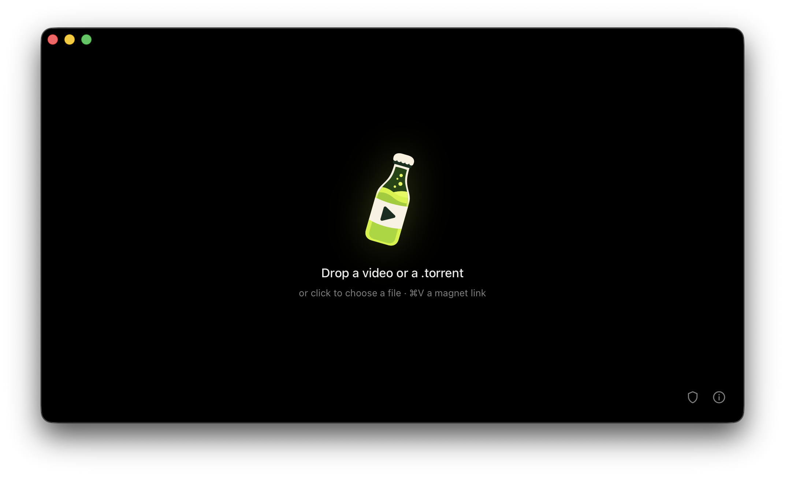

<p align="center">
  
</p>

<h1 align="center">Tonic Player</h1>

<p align="center">Video player for local files and torrents, streamed while they download, with Chromecast and AirPlay.</p>

<p align="center">
  <a href="https://github.com/lupodevelop/tonic-player/releases">Download</a>
</p>

<p align="center">
  
</p>

## Features

- Drop a video, a folder or a `.torrent` file on the window, or paste a magnet link.
- Torrents play while they download.
- MKV, AVI and other formats play too, converted on the fly.
- Chromecast and AirPlay.
- 360° and 180° VR videos: drag to look around.
- Seek bar previews and chapters.
- Mini player that stays above other apps.
- Small videos scaled up sharp with AMD FSR.
- Shield: torrents go through your VPN provider's SOCKS5 proxy.
- Nothing is kept on disk: torrent data and converted video are deleted when the app quits.

Keys: space play/pause, ← → seek, ↑ ↓ volume, M mute, F full screen, P mini player, U upscaling, V VR/2D.

## Install

Download the build for your system from [Releases](https://github.com/lupodevelop/tonic-player/releases). The app updates itself.

The builds are not signed. On macOS, open the app the first time with right click → Open. On Windows, choose More info → Run anyway.

macOS is the tested platform; Windows and Linux builds are not tested yet.

## Good to know

- With the shield on, DHT and UDP trackers are off: torrents find fewer peers, and a magnet link needs an HTTP tracker.
- Cast devices fetch the video from the app over your network. Stream addresses carry a random token, but anyone on the network who sees one can read that file.

## Build

Needs Rust, Node.js with pnpm, the [Tauri prerequisites](https://tauri.app/start/prerequisites/) and, to package, `cargo install cargo-about --locked --features cli`.

```sh
pnpm install
pnpm tauri dev      # run
pnpm tauri build    # package
pnpm test && cargo test --manifest-path src-tauri/Cargo.toml
```

## License

[GPL-3.0-or-later](LICENSE). Bundles [FFmpeg](https://ffmpeg.org), built in [tonic-player-ffmpeg](https://github.com/lupodevelop/tonic-player-ffmpeg).

## Support

<a href="https://ko-fi.com/lupodevelop"></a>

If Tonic Player is useful to you, [a coffee on Ko-fi](https://ko-fi.com/lupodevelop) keeps it going.
